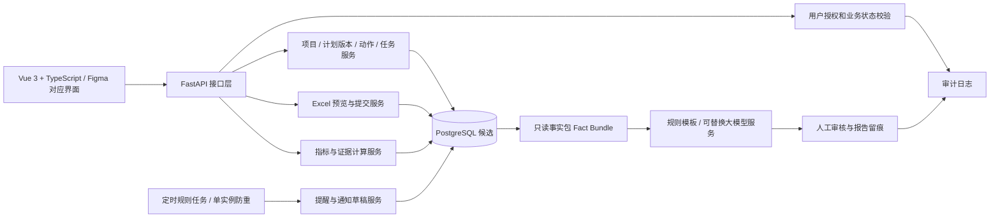
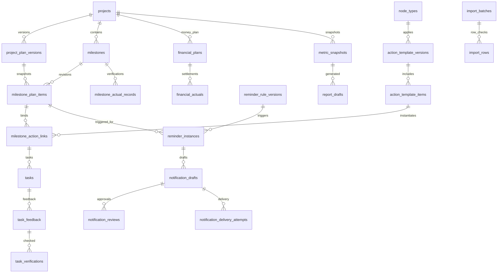
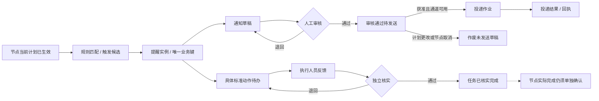

# 项目总体量化评估智能体（第一期）
# 数据库结构与后端 API 详细设计 V0.2

> **状态：技术预设计 / 待业务及信息化评审；不是正式建设基线，也不是已编写或已运行的后端代码。**  
> 编制日期：2026-10-19  
> 本次成果：逻辑/物理模型候选、字段数据字典、接口契约、业务状态机、计算口径、模拟数据映射、验收追踪。  
> 使用场景：开发前评审、研发任务拆解、DB/API 方案确认和将来的测试准备。

## 0. 依据、变更与设计边界

### 0.1 本次核对的材料

| 依据 | 本次实际使用内容 | 对应地位 |
|---|---|---|
| 《项目总体量化评估智能体_第一期项目计划书_按原模板(1).docx》 | 一期业务闭环、风险、资料清单、阶段日期和验收原则 | **项目计划来源** |
| 《项目总体量化评估智能体_第一期_系统需求设计说明书_V0.1.docx》 | F-01～F-25 功能编号、业务对象、权限候选及逻辑模型 | **需求初稿，未评审** |
| 《项目总体量化评估智能体_第一期技术设计草案_V0.1.md》 | Vue 3/FastAPI/PostgreSQL 候选、提醒幂等、数据质量和模型约束 | **既有技术建议** |
| 《项目总体量化评估智能体_模拟测试数据_V0.1.xlsx》 | 8 工作表、3 项目、67 节点、11 条通知及 18 条测试用例 | **可复算模拟数据，不是真实业务记录** |
| Figma 原型 V0.7（项目总体量化评估智能体） | 28 个画面：七主模块以及新增、详情、导入、审核、待办、评价追溯状态 | **交互参考，不代表功能已实现** |

**来源与建议严格区分：** 项目管理、节点计划、标准动作、提醒通知、反馈、量化指标及 AI 辅助报告来自计划书和需求初稿。下文的表名、UUID、HTTP 路径、状态枚举、锁策略和字段长度均为本次技术建议；没有真实样例或正式规则的部分标注“待业务确认”，不得直接作为生产口径。

### 0.2 V0.2 相对 V0.1 的实质补充

1. 将 V0.1 的逻辑对象拆分成 **30 张候选表**，明确主键、关联、版本、数据类型、唯一性和查询索引。
2. 固定“稳定节点身份 + 项目计划版本快照 + 实际记录独立核实”的核心组织方式；避免直接更新历史计划。
3. 将“提醒生成、通知审核、真实投递、任务执行、节点完成”拆成不同状态与数据表，禁止跨环节自动跳状态。
4. 形成可拆分研发任务的 HTTP API 目录、统一入参与错误约定、典型请求和返回样例。
5. 逐项映射 Excel 中 TC-001～TC-018，用演示事实验证计划版本、按期率、提醒去重、收付分离及 AI 生成约束。
6. 明确短期可做的设计工作与计划中的**正式开发时间**，不会因已有 Figma/Excel 就提前宣称功能上线。

### 0.3 一期不做及默认关闭

- 不直接收付款、不发出支付指令、不执行合同审批，也不以内部预计计划推定合同义务。
- 外部消息推送（邮件、企业 IM）、与财务/ERP 的直接同步，在渠道、权限及安全评审前默认关闭；可先演示站内通知草稿。
- AI 不对数据库作直接修改，不独立判定“已支付、已到账、延期责任人或综合考核得分”。
- 无正式指标权重时不出具“全项目综合评分”；原型百分比只是**模拟、可复算、待确认**的指标。

## 1. 总体技术架构与数据流



建议采用**模块化单体后端**，初版不引入微服务。数据库候选 PostgreSQL、ORM 候选 SQLAlchemy 2、迁移候选 Alembic，最终与公司 IT 标准、服务器现状确认；前端技术采用已有系统工作习惯下的 Vue 3 + TypeScript。定时任务与 API 服务需防止多实例重复扫描。AI 生成是从业务事实包出发的**下游可选能力**，模型不可用不应阻断台账和提醒计算。

## 2. 统一字段、键与时间约定

| 内容 | V0.2 方案 | 需要注意 |
|---|---|---|
| 内部主键 | UUID；业务编码单独保存 | 业务编码如 `P-H028`、`H028-N011` 不用作关联外键 |
| 版本 | 项目计划、动作模板和提醒规则各自版本化 | 新版批准后历史不可覆盖；快照与当前生效版本分开 |
| 审计时间 | `timestamptz`，系统按统一时区存储；API 统一 ISO8601 | 节点计划日是 `date`，不是 UTC 时间戳 |
| 演示本地业务日 | 以 `2026-10-19` 为统计/模拟运行日 | 生产业务时区及跨日边界需 IT/业务确认 |
| 空值 `null` | 未录入、未知、待核实使用 `null`+状态 | **禁止把未知实际金额写 0**；公式 0 只代表“已核实金额汇总为零”，不能推定事实未发生 |
| 金额 | `numeric(18,2)` + `currency` | 多币种不可直接汇总，汇率来源与折算规则另行确认 |
| 并发 | `row_version` + `If-Match` 乐观锁 | 修改后必须重新获取最新记录 |
| 提交防重 | `Idempotency-Key` + DB 唯一约束 | Excel commit、提醒生成和真实发送分别防重 |
| 证据 | `source_document_id`/`evidence_document_id` 与来源类别 | 不能上传本机路径冒充审核材料 |
| 操作者 | 服务端从认证主体解析 | 审核人和修改人不得由普通客户端随意指定 |
| 删除 | 已产生业务历史的对象用状态停用/归档 | 合同与审核留痕不得物理删除 |

### 2.1 数据关联总览（候选 ER）



**关键取舍：** `milestones` 只表示稳定节点身份，`milestone_plan_items` 记录每个生效计划版本的完整快照。计划从 V2 改成 V3 时，保留 V2 的日期、责任与来源，不允许拿新日期覆盖历史；提醒明确引用当时的计划快照，才能判断哪个通知应失效。财务实际记录与计划记录是两个对象，且允许同一计划关联多笔实际记录。

## 3. 候选数据库数据字典

表名前缀不增加复杂命名空间；按业务领域划分在服务层。`PK` 为主键、`FK` 为外键。以下是设计字段，不表示实际表已经创建。

### 3.01 `departments` — 部门目录（试点可手工配置）

| 字段 | 候选类型与约束 | 业务说明 / 校验 |
|---|---|---|
| `id` | `UUID PK` | 内部唯一标识 |
| `dept_code` | `varchar(40), UNIQUE` | 公司部门代码；真实编码规则待确认 |
| `dept_name` | `varchar(100)` | 部门名称 |
| `enabled` | `boolean` | 停用不删除历史引用 |
| `source_system` | `varchar(40), NULL` | 当前可为 manual；预留统一组织体系 |

### 3.02 `users` — 人员目录（不保存密码）

| 字段 | 候选类型与约束 | 业务说明 / 校验 |
|---|---|---|
| `id` | `UUID PK` | 内部唯一标识 |
| `employee_code` | `varchar(50), UNIQUE` | 人员标识待统一目录确认 |
| `display_name` | `varchar(100)` | 姓名展示，仅示例人员 |
| `department_id` | `UUID FK departments` | 当前部门 |
| `enabled` | `boolean` | 离职停用保留历史责任引用 |

### 3.03 `project_members` — 项目级访问和责任范围

| 字段 | 候选类型与约束 | 业务说明 / 校验 |
|---|---|---|
| `id` | `UUID PK` | 记录主键 |
| `project_id` | `UUID FK projects` | 项目 |
| `user_id` | `UUID FK users` | 参与人 |
| `role_code` | `varchar(50)` | project_admin / node_editor / task_executor / finance_reviewer / viewer 等候选值 |
| `active` | `boolean` | 是否生效 |
| `unique_tuple` | `UNIQUE(project_id,user_id,role_code)` | 防止重复授权；最终角色以业务评审为准 |

### 3.04 `projects` — 项目主数据

| 字段 | 候选类型与约束 | 业务说明 / 校验 |
|---|---|---|
| `id` | `UUID PK` | 内部主键 |
| `project_code` | `varchar(64), NOT NULL UNIQUE` | 业务项目编号，例如 P-H028；不可静默覆盖 |
| `project_name` | `varchar(200), NOT NULL` | 项目名称 |
| `project_type` | `varchar(60), NULL` | 类型字典待业务确认 |
| `owner_id / department_id` | `UUID FK, NULL` | 负责人及责任部门 |
| `project_status` | `varchar(30), NOT NULL` | draft / not_started / active / completed / archived 候选 |
| `planned_start / planned_end` | `date, NULL` | 内部预计时间，非合同履约日期 |
| `current_plan_version_id` | `UUID FK, NULL` | 仅引用已确认生效版本，须校验同项目 |
| `row_version` | `integer, DEFAULT 1` | 乐观锁；任何编辑递增 |
| `created_at / updated_at / created_by` | `timestamptz / UUID` | 审计信息 |

### 3.05 `project_plan_versions` — 项目计划版本

| 字段 | 候选类型与约束 | 业务说明 / 校验 |
|---|---|---|
| `id` | `UUID PK` | 版本主键 |
| `project_id` | `UUID FK projects` | 所属项目 |
| `version_label` | `varchar(30)` | 例如 V1/V2/V3，同项目唯一 |
| `status` | `varchar(30)` | draft / pending_review / approved / effective / superseded / rejected |
| `source_document_id` | `UUID FK attachments, NULL` | 计划依据 |
| `change_reason` | `text, NULL` | 变更原因 |
| `approved_by / approved_at` | `UUID / timestamptz, NULL` | 确认人及时间 |
| `effective_at` | `timestamptz, NULL` | 版本生效时刻 |
| `row_version` | `integer` | 防并发提交变更 |

### 3.06 `milestones` — 跨版本稳定节点身份

| 字段 | 候选类型与约束 | 业务说明 / 校验 |
|---|---|---|
| `id` | `UUID PK` | 节点主键 |
| `project_id` | `UUID FK projects` | 所属项目 |
| `milestone_code` | `varchar(64)` | 项目内唯一，例如 H028-N011 |
| `milestone_name` | `varchar(200)` | 节点名称 |
| `node_type_code` | `varchar(64) FK node_types` | 节点类型 |
| `lifecycle_status` | `varchar(30)` | active / cancelled；延期不是人工填写的状态 |
| `created_at / created_by` | `timestamptz / UUID` | 创建留痕 |
| `unique_tuple` | `UNIQUE(project_id,milestone_code)` | 避免跨项目业务编号冲突 |

### 3.07 `milestone_plan_items` — 节点计划版本快照（每版全量）

| 字段 | 候选类型与约束 | 业务说明 / 校验 |
|---|---|---|
| `id` | `UUID PK` | 修订快照主键 |
| `milestone_id` | `UUID FK milestones` | 稳定节点 |
| `plan_version_id` | `UUID FK project_plan_versions` | 对应计划版本 |
| `planned_date` | `date, NOT NULL` | 该版计划完成日期 |
| `date_kind` | `varchar(30)` | contractual / internal_plan；不能互相推定 |
| `department_id / owner_id` | `UUID FK, NULL` | 该版责任快照 |
| `source_document_id` | `UUID FK attachments, NULL` | 日期依据文件 |
| `change_reason` | `text, NULL` | 为何调整 |
| `is_included` | `boolean` | 该版是否纳入生效节点集合 |
| `unique_tuple` | `UNIQUE(milestone_id,plan_version_id)` | 一节点一版本一条记录；项目归属一致性校验 |

### 3.08 `milestone_actual_records` — 节点实际记录与独立核实

| 字段 | 候选类型与约束 | 业务说明 / 校验 |
|---|---|---|
| `id` | `UUID PK` | 记录主键，保留多次提交 |
| `milestone_id` | `UUID FK milestones` | 关联节点 |
| `actual_date` | `date, NULL` | 如仅已知尚未完成则允许空；不可补今天 |
| `completion_flag` | `boolean, NULL` | true/false/null 区分已完成、核实尚未完成、未知 |
| `verification_status` | `varchar(30)` | submitted / verified / returned / disputed |
| `evidence_document_id` | `UUID FK attachments, NULL` | 客观来源 |
| `submitted_by / submitted_at` | `UUID / timestamptz` | 提交人员及时间 |
| `verified_by / verified_at` | `UUID / timestamptz, NULL` | 核实人、核实时间 |
| `is_current` | `boolean` | 同一节点仅一条当前核实事实；旧记录不删除 |

### 3.09 `attachments` — 文件元数据及证据引用

| 字段 | 候选类型与约束 | 业务说明 / 校验 |
|---|---|---|
| `id` | `UUID PK` | 文件主键 |
| `original_name` | `varchar(255)` | 文件名；需校验扩展名与内容 |
| `storage_key` | `varchar(500)` | 内部受控文件位置，不对前端泄露任意服务器路径 |
| `checksum_sha256` | `char(64)` | 防篡改、重复标识 |
| `content_type / size_bytes` | `varchar(100) / bigint` | 限制类型与容量 |
| `uploader_id / uploaded_at` | `UUID / timestamptz` | 上传留痕 |
| `classification` | `varchar(30)` | 普通/业务/合同/财务等访问等级待确认 |

### 3.10 `node_types` — 节点类型字典

| 字段 | 候选类型与约束 | 业务说明 / 校验 |
|---|---|---|
| `code` | `varchar(64) PK` | 合同签订、收款准备、付款准备、设计、验收等候选 |
| `display_name` | `varchar(100)` | 展示名称 |
| `category` | `varchar(40)` | contract / internal / financial / acceptance 等候选 |
| `enabled` | `boolean` | 历史不随字典停用删除 |
| `approval_ref` | `varchar(150), NULL` | 业务批准依据 |

### 3.11 `action_template_versions` — 动作模板及其版本

| 字段 | 候选类型与约束 | 业务说明 / 校验 |
|---|---|---|
| `id` | `UUID PK` | 模板版本标识 |
| `template_code` | `varchar(64)` | 同逻辑模板的稳定编号 |
| `version_label` | `varchar(30)` | 版本号 |
| `node_type_code` | `varchar(64) FK node_types` | 适用节点类型 |
| `applicability_json` | `jsonb` | 适用条件需白名单结构化，不执行任意代码 |
| `status` | `varchar(30)` | draft / pending_review / approved / retired |
| `approved_by / approved_at` | `UUID / timestamptz, NULL` | 模板生效前必须批准 |
| `unique_tuple` | `UNIQUE(template_code,version_label)` | 版本唯一 |

### 3.12 `action_template_items` — 模板标准动作项

| 字段 | 候选类型与约束 | 业务说明 / 校验 |
|---|---|---|
| `id` | `UUID PK` | 动作项主键 |
| `template_version_id` | `UUID FK action_template_versions` | 不可只引用模板代码 |
| `item_code` | `varchar(50)` | 版本内序号或动作编号 |
| `title` | `varchar(240)` | 具体准备动作 |
| `materials_required_json` | `jsonb` | 需准备材料清单 |
| `default_department_id` | `UUID FK departments, NULL` | 默认责任部门 |
| `completion_criteria` | `text, NULL` | 完成判定及证据要求 |
| `sort_order` | `integer` | 展示与生成顺序 |
| `unique_tuple` | `UNIQUE(template_version_id,item_code)` | 模板版本内不重复 |

### 3.13 `milestone_action_links` — 节点绑定的标准动作快照

| 字段 | 候选类型与约束 | 业务说明 / 校验 |
|---|---|---|
| `id` | `UUID PK` | 绑定主键 |
| `milestone_id` | `UUID FK milestones` | 关联稳定节点 |
| `template_item_id` | `UUID FK action_template_items` | 关联已批准模板动作 |
| `plan_item_id` | `UUID FK milestone_plan_items` | 绑定时采用的节点版本 |
| `override_reason / overrides_json` | `text / jsonb, NULL` | 经授权修改原因及安全字段 |
| `status` | `varchar(30)` | active / superseded / cancelled |
| `assigned_department_id` | `UUID FK departments, NULL` | 该节点实际执行部门 |

### 3.14 `work_calendars` — 工作日历（需企业确认）

| 字段 | 候选类型与约束 | 业务说明 / 校验 |
|---|---|---|
| `id` | `UUID PK` | 日历主键 |
| `calendar_code` | `varchar(50)` | 例如 CN-PLANT-2027，仅示意 |
| `timezone_name` | `varchar(50)` | 建议使用 Asia/Shanghai；待公司确认 |
| `status` | `varchar(30)` | draft / approved / retired |
| `approved_by / approved_at` | `UUID / timestamptz, NULL` | 未审批时不得作为生产规则依据 |
| `source_document_id` | `UUID FK attachments, NULL` | 节假日及调休依据 |

### 3.15 `work_calendar_days` — 工作/非工作日覆盖

| 字段 | 候选类型与约束 | 业务说明 / 校验 |
|---|---|---|
| `id` | `UUID PK` | 日历日期项 |
| `calendar_id` | `UUID FK work_calendars` | 所属日历 |
| `calendar_date` | `date` | 日期 |
| `is_workday` | `boolean` | 显式反映节假日及调休 |
| `reason` | `varchar(160), NULL` | 例如节假日、调休 |
| `unique_tuple` | `UNIQUE(calendar_id,calendar_date)` | 一个日期唯一 |

### 3.16 `reminder_rule_versions` — 提醒规则版本

| 字段 | 候选类型与约束 | 业务说明 / 校验 |
|---|---|---|
| `id` | `UUID PK` | 规则版本主键 |
| `rule_code / version_label` | `varchar(64) / varchar(30)` | 稳定规则编号与版本 |
| `node_type_code` | `varchar(64) FK node_types` | 关联节点类型 |
| `days_before` | `integer >= 0` | 提前 N 天；具体数字待确认 |
| `day_basis` | `varchar(20)` | calendar_day / workday |
| `calendar_id` | `UUID FK work_calendars, NULL` | 工作日时必填且已批准 |
| `recipient_role_code` | `varchar(60)` | 接收人角色配置；发送前解析到真实人员 |
| `status / approved_by / approved_at` | `varchar(30) / UUID / timestamptz` | 经批准才可生效 |
| `unique_tuple` | `UNIQUE(rule_code,version_label)` | 保留历史版本 |

### 3.17 `reminder_instances` — 生成提醒的幂等单元

| 字段 | 候选类型与约束 | 业务说明 / 校验 |
|---|---|---|
| `id` | `UUID PK` | 提醒主键 |
| `milestone_plan_item_id` | `UUID FK milestone_plan_items` | 固定节点计划快照 |
| `rule_version_id` | `UUID FK reminder_rule_versions` | 固定规则版本 |
| `recipient_user_id` | `UUID FK users` | 真实接收人 |
| `trigger_date` | `date` | 提前提醒日期 |
| `occurrence_no` | `integer DEFAULT 1` | 多轮提醒序号；策略待确认 |
| `idempotency_key` | `varchar(160) UNIQUE` | 修订版+规则版+日期+接收人+轮次摘要 |
| `status` | `varchar(30)` | scheduled / draft_created / invalidated / skipped / error |
| `invalidated_reason` | `text, NULL` | 计划改变、节点取消等 |
| `generated_at` | `timestamptz, NULL` | 生成时刻 |

### 3.18 `tasks` — 由动作关联生成的工作任务

| 字段 | 候选类型与约束 | 业务说明 / 校验 |
|---|---|---|
| `id` | `UUID PK` | 任务主键 |
| `reminder_instance_id` | `UUID FK reminder_instances, NULL` | 允许非提醒触发的手工任务 |
| `milestone_action_link_id` | `UUID FK milestone_action_links` | 来源动作快照 |
| `assignee_id` | `UUID FK users, NULL` | 明确负责人后才可分派 |
| `due_date` | `date, NULL` | 动作完成建议日期 |
| `status` | `varchar(30)` | unassigned / todo / in_progress / submitted / verified_done / returned / cancelled |
| `row_version` | `integer` | 防任务状态覆盖 |
| `created_at` | `timestamptz` | 任务创建时间 |

### 3.19 `task_feedback` — 任务执行反馈记录

| 字段 | 候选类型与约束 | 业务说明 / 校验 |
|---|---|---|
| `id` | `UUID PK` | 反馈主键 |
| `task_id` | `UUID FK tasks` | 关联任务 |
| `comment` | `text, NOT NULL` | 反馈说明 |
| `claimed_completion` | `boolean, NULL` | 用户声称完成，与核实事实不同 |
| `submitted_by / submitted_at` | `UUID / timestamptz` | 操作人及时间 |
| `attachment_ids_json` | `jsonb, NULL` | 附件ID列表；生产可改为关联表 |
| `status` | `varchar(30)` | submitted / under_review / verified / returned |

### 3.20 `task_verifications` — 独立的任务核实事件

| 字段 | 候选类型与约束 | 业务说明 / 校验 |
|---|---|---|
| `id` | `UUID PK` | 核实主键 |
| `feedback_id` | `UUID FK task_feedback` | 针对具体反馈版本 |
| `decision` | `varchar(30)` | accepted / returned / disputed |
| `comment` | `text, NULL` | 核实意见 |
| `reviewer_id / reviewed_at` | `UUID / timestamptz` | 核实人及时间 |

### 3.21 `notification_drafts` — 业务通知草稿与版本

| 字段 | 候选类型与约束 | 业务说明 / 校验 |
|---|---|---|
| `id` | `UUID PK` | 通知主键 |
| `reminder_instance_id` | `UUID FK reminder_instances` | 生成来源 |
| `draft_version` | `integer` | 每次正文修订递增 |
| `recipient_user_id` | `UUID FK users` | 当前接收对象 |
| `title / body` | `varchar(200) / text` | 通知标题及正文 |
| `fact_snapshot_json` | `jsonb` | 生成当时的节点、动作与版本事实 |
| `status` | `varchar(30)` | draft / pending_review / returned / approved_pending_send / sending / sent / delivery_failed / invalidated |
| `row_version` | `integer` | 审核并发与内容变更保护 |
| `created_at / updated_at` | `timestamptz` | 草稿时间 |

### 3.22 `notification_reviews` — 通知审核与退回流水

| 字段 | 候选类型与约束 | 业务说明 / 校验 |
|---|---|---|
| `id` | `UUID PK` | 审核流水ID |
| `notification_id` | `UUID FK notification_drafts` | 关联草稿 |
| `draft_version` | `integer` | 审批绑定的内容版本，防止“审核后被改写” |
| `decision` | `varchar(30)` | approved / returned |
| `comment` | `text, NULL` | 退回原因等 |
| `reviewer_id / reviewed_at` | `UUID / timestamptz` | 审查人及时间 |

### 3.23 `notification_delivery_attempts` — 投递尝试（接口启用后）

| 字段 | 候选类型与约束 | 业务说明 / 校验 |
|---|---|---|
| `id` | `UUID PK` | 尝试ID |
| `notification_id` | `UUID FK notification_drafts` | 通知 |
| `channel` | `varchar(40)` | in_app / email / enterprise_messaging 等候选 |
| `destination_ref` | `varchar(160)` | 站内用户/外部通道的受控目标引用 |
| `provider_message_id` | `varchar(200), NULL` | 外部回执 |
| `attempt_state` | `varchar(30)` | queued / accepted / delivered / failed / unknown |
| `attempted_at / finished_at` | `timestamptz / timestamptz NULL` | 发送尝试时间 |
| `failure_reason` | `text, NULL` | 失败原因 |
| `attempt_no` | `integer` | 同一通知的发送轮次 |

### 3.24 `financial_plans` — 计划收付款记录

| 字段 | 候选类型与约束 | 业务说明 / 校验 |
|---|---|---|
| `id` | `UUID PK` | 计划主键 |
| `project_id / milestone_id` | `UUID FK` | 关联项目及可选节点 |
| `direction` | `varchar(10)` | receivable / payable |
| `planned_date` | `date` | 计划日期，保留来源类型 |
| `planned_amount` | `numeric(18,2)` | 计划金额，非已发生金额 |
| `currency` | `char(3)` | 币种，首期默认值应待确认 |
| `date_source_kind` | `varchar(30)` | contractual / internal_plan |
| `source_document_id` | `UUID FK attachments` | 依据来源 |
| `verification_status` | `varchar(30)` | pending / verified / disputed |
| `created_at` | `timestamptz` | 记录时间 |

### 3.25 `financial_actuals` — 已发生收付款事实（与计划分离）

| 字段 | 候选类型与约束 | 业务说明 / 校验 |
|---|---|---|
| `id` | `UUID PK` | 实际记录ID |
| `financial_plan_id` | `UUID FK financial_plans, NULL` | 允许多笔、部分到账/支付 |
| `project_id` | `UUID FK projects` | 关联项目 |
| `direction` | `varchar(10)` | receipt / payment；与计划方向对应 |
| `actual_date` | `date, NOT NULL` | 实际发生日期 |
| `actual_amount` | `numeric(18,2), NOT NULL` | 事实金额，不允许由计划自动填充 |
| `currency` | `char(3)` | 需与相关计划币种对齐 |
| `evidence_document_id` | `UUID FK attachments` | 财务凭证，必填/可暂存待核实 |
| `verification_status` | `varchar(30)` | submitted / verified / returned |
| `verified_by / verified_at` | `UUID / timestamptz, NULL` | 财务核实信息 |

### 3.26 `import_batches` — Excel 导入事务批次

| 字段 | 候选类型与约束 | 业务说明 / 校验 |
|---|---|---|
| `id` | `UUID PK` | 导入批次ID |
| `target_entity` | `varchar(35)` | projects / milestones / financial_plan 等已支持类型 |
| `source_file_id` | `UUID FK attachments` | 来源文件 |
| `mapping_json / mapping_version` | `jsonb / varchar(30)` | 字段映射快照 |
| `status` | `varchar(30)` | uploaded / validated / committing / committed / partial / failed / expired |
| `preview_hash` | `char(64)` | 预览与提交数据一致性检查 |
| `idempotency_key` | `varchar(160) UNIQUE` | 重复提交同批次不会重复写入 |
| `created_by / created_at / committed_at` | `UUID / timestamptz / timestamptz NULL` | 导入审计 |

### 3.27 `import_rows` — Excel 逐行处理与错误记录

| 字段 | 候选类型与约束 | 业务说明 / 校验 |
|---|---|---|
| `id` | `UUID PK` | 行主键 |
| `batch_id` | `UUID FK import_batches` | 批次 |
| `sheet_name / source_row_number` | `varchar(80) / integer` | 定位原表格行 |
| `raw_json / normalized_json` | `jsonb / jsonb` | 源值与标准化值 |
| `validation_errors_json` | `jsonb` | 错误码及字段原因 |
| `row_status` | `varchar(30)` | valid / error / duplicate / skipped / inserted |
| `target_record_id` | `UUID, NULL` | 成功写入对象 |
| `unique_tuple` | `UNIQUE(batch_id,sheet_name,source_row_number)` | 批次内行身份唯一 |

### 3.28 `metric_snapshots` — 评价快照及可复算依据

| 字段 | 候选类型与约束 | 业务说明 / 校验 |
|---|---|---|
| `id` | `UUID PK` | 评价快照ID |
| `project_id` | `UUID FK projects` | 所属项目 |
| `as_of_date` | `date` | 统计截止日 |
| `plan_version_id` | `UUID FK project_plan_versions` | 所用计划基准 |
| `formula_version` | `varchar(30)` | 如 demo_v01；正式口径待批准 |
| `numerators_json / denominators_json` | `jsonb / jsonb` | 明确分子分母及排除项 |
| `results_json / quality_json` | `jsonb / jsonb` | 原始计算值与数据完整性提示 |
| `source_digest` | `char(64)` | 输入记录摘要，用于复算 |
| `created_by / created_at` | `UUID / timestamptz` | 计算人员/程序及时间 |

### 3.29 `report_drafts` — 受控AI阶段报告草稿

| 字段 | 候选类型与约束 | 业务说明 / 校验 |
|---|---|---|
| `id` | `UUID PK` | 报告主键 |
| `project_id / metric_snapshot_id` | `UUID FK` | 报告依据 |
| `fact_bundle_json` | `jsonb` | 经后端整理的事实包，不给模型写权限 |
| `generator_type / model_id` | `varchar(25) / varchar(120), NULL` | rule_template / llm；模型信息 |
| `content / validation_json` | `text / jsonb` | 生成正文及事实引用检查结果 |
| `review_status` | `varchar(30)` | draft / pending_review / returned / approved |
| `reviewer_id / reviewed_at` | `UUID / timestamptz, NULL` | 人工审核 |
| `generated_at` | `timestamptz` | 生成时间 |

### 3.30 `audit_events` — 跨模块不可变审计事件

| 字段 | 候选类型与约束 | 业务说明 / 校验 |
|---|---|---|
| `id` | `UUID PK` | 审计记录ID |
| `entity_type / entity_id` | `varchar(60) / UUID` | 被修改业务对象 |
| `action` | `varchar(90)` | create / edit / change_plan / review / import_commit 等 |
| `actor_id / occurred_at` | `UUID / timestamptz` | 操作主体和时间 |
| `before_json / after_json` | `jsonb, NULL` | 脱敏的变更摘要 |
| `request_id / trace_id` | `varchar(80)` | 关联API及作业执行链路 |
| `source_kind` | `varchar(40)` | manual / excel / rule_job / approved_integration |

## 4. 约束、索引与事务边界

### 4.1 必须落在数据库层的约束

| 约束 | 目的 | 发生冲突时 |
|---|---|---|
| `projects.project_code` 唯一 | 防止 Excel 和人工同时建重号 | 409 `PROJECT_CODE_EXISTS` |
| `(project_id, version_label)` 唯一 | 防止计划版本名称碰撞 | 409 `PLAN_VERSION_EXISTS` |
| `(project_id, milestone_code)` 唯一 | 节点稳定身份 | 409 `MILESTONE_CODE_EXISTS` |
| `(milestone_id, plan_version_id)` 唯一 | 同版计划不允许一节点重复快照 | 409 `MILESTONE_PLAN_DUPLICATE` |
| 一个项目同时只能有一个 `effective` 计划 | 生效基准清晰，禁止并行变更覆盖 | 事务 + 唯一部分索引/行锁 |
| 一个节点同时只能有一个 `is_current=true AND verification_status=verified` 的实际事实 | 防止多个互相矛盾的“当前已核实记录” | 提交新记录并人工复核后才切换当前指针 |
| `reminder_instances.idempotency_key` 唯一 | 同一规则/节点/接收人/轮次不重复提醒 | 重试返回原实例，不新增草稿 |
| `import_batches.idempotency_key` 唯一 | 重复点击确认不重复导入 | 返回原批次写入结果 |
| 实际收付款金额、币种、时间及核实人互相独立 | 防止把计划当实收 | 未核实事实不能进入实收汇总 |

### 4.2 首期建议索引

| 实体 | 建议索引 | 访问路径 |
|---|---|---|
| `projects` | `(project_status,project_type)` / `(owner_id)` | 项目列表状态与负责人筛选 |
| `milestones` | `(project_id,node_type_code,lifecycle_status)` | 节点时间轴、类型筛选 |
| `milestone_plan_items` | `(plan_version_id,planned_date)` | 到期节点与提醒预览 |
| `milestone_actual_records` | `(milestone_id,is_current,verification_status)` | 核实状态、评价统计 |
| `reminder_instances` | `(trigger_date,status)` | 到期提醒扫描 |
| `notification_drafts` | `(recipient_user_id,status,created_at DESC)` | 我的通知与待审批 |
| `tasks` | `(assignee_id,status,due_date)` | 我的待办 |
| `import_rows` | `(batch_id,row_status)` | 错误行下载与预览 |
| `financial_actuals` | `(project_id,verification_status,actual_date)` | 已核实资金事实 |
| `metric_snapshots` | `(project_id,as_of_date,created_at DESC)` | 快照检索/历史趋势 |

索引与表拆分均为初稿，实际需按试点数据量、检索频率和企业数据库标准评估。**明确的事务边界：**（A）计划审核生效 + 当前版本切换 + 旧提醒失效；（B）Excel commit 批次行级校验 + 写入 + 审计（选择全量回滚或有效行子事务，需业务确认）；（C）通知草稿审核 + 固定草稿版本；（D）提交核实结果 + 旧当前版本退役；（E）指标快照生成 + 来源摘要保存。外部邮件/消息发送不纳入数据库事务，在独立投递作业中处理重试和回执。

## 5. 业务状态与操作规则

### 5.1 必须独立保存的四类状态

| 维度 | 候选状态 | 不允许的捷径 |
|---|---|---|
| **节点生命周期** | active、cancelled；执行推进可另记任务状态 | 不把“晚3天”存成节点生命周期状态 |
| **实际记录核实** | submitted、verified、returned、disputed；带 completion_flag | 提交反馈不能直接记为已核实完成 |
| **任务状态** | unassigned → todo → in_progress → submitted → verified_done；支持 returned/cancelled | 单条动作完成不能推出整个里程碑完成 |
| **通知状态** | draft → pending_review → approved_pending_send → sending → sent；可 returned、invalidated、delivery_failed | `approved_pending_send` 不等于 `sent` 或 `delivered` |



### 5.2 规则引擎计算步骤（非可执行代码）

1. 获取指定 `as_of_date` 的生效计划版本与未取消节点；校验节点计划来源可用。
2. 找到已审批的标准动作与规则版本；未配置/未审批时输出 `CONFIGURATION_PENDING`，不生成对外可用通知。
3. 日期计算：自然日按日期减 `days_before`；工作日先确认企业工作日历，再按有效工作日倒推。无日历时为 `CALENDAR_NOT_APPROVED`，不能只用“排除周末”作为正式计算。
4. 判断触发时点、节点已核实完成、计划版本变化、已存在提醒等因素；为生成候选给出明确 `eligible / skipped_reason`。
5. 用节点计划快照 ID + 规则版本 ID + 触发日期 + 实际接收人 ID + 轮次构成唯一键，数据库写入时再次检查。
6. 生成的是**待审核草稿**和待办，正文由确认的事实与标准动作组成。通知审核通过后仅变为“待发送”；对外投递须另获通道配置与授权。
7. 节点计划版本更新：旧未投递草稿/有效未来提醒作废，已投递历史保持只读；依据新版本重新判断是否应产生提醒。

### 5.3 指标口径 V0.2（沿用 Excel 的模拟规则，不是正式绩效标准）

- 到期集合 `D`：计划生效且未取消、`planned_date <= as_of_date` 的可评价节点。
- 已核实按期集合 `O`：有当前已核实的已完成记录，且 `actual_date <= planned_date`。
- 已核实延期完成集合 `L`：已核实完成，且 `actual_date > planned_date`。
- `U`（待核对）：计划已到期，但实际完成记录不足或尚未核实。**不得与 `L` 合并**。
- **模拟按期率** `|O| / (|O|+|L|)`，分母为 0 显示“暂无可核实数据”；**覆盖率** `(|O|+|L|)/|D|`。
- “已核实尚未完成且超期”的记录应独立展示 `confirmed_overdue_unfinished`；其分母如何参与正式项目评价，**待业务确认**，不能拿这个演示公式作正式考核规则。
- 所有聚合必须先汇总分子分母再计算比例，不能对各项目百分比直接取平均。

| Excel V0.1 模拟项目 | 全部节点 | 到期 D | 按期 O | 延期 L | 待核对 U | 已核实分母 | 模拟按期率 |
|---|---:|---:|---:|---:|---:|---:|---:|
| P-H028 | 26 | 16 | 14 | 1 | 1 | 15 | 93.3% |
| P-H031 | 24 | 12 | 10 | 2 | 0 | 12 | 83.3% |
| P-H014 | 17 | 8 | 6 | 1 | 1 | 7 | 85.7% |
| **合计** | **67** | **36** | **30** | **4** | **2** | **34** | **88.2%** |

Excel 的状态公式以 `2026-10-19` 为示例截止日。P-H028 的 `H028-N006` 计划 10-12、核实实际 10-15，偏差 **+3 自然日**；`H028-N008` 实际记录待核实，不能直接判为延期；`H028-N011` 计划 10-26，截止 10-19 尚未到期。财务示例中 `FIN-028-01` 为计划收款 **800 万元**，实收金额与日期缺失；不能据此确认已经收款。`FIN-031-01` 则为**模拟已核实**实收 400 万元，仅限测试。

### 5.4 业务“未知”不等于数值 0

- 财务计划不代表真实发生：`financial_plans` 中计划金额不自动复制到 `financial_actuals`。
- 若不存在或未核实实际资金记录，`verified_actual_total` 可以单列当前已核实金额合计，但**必须同时返回 `actual_data_complete=false` 或 `unverified_count>0`**，不能将零误读为款项未发生。
- 模型报告引用未核实资金信息时只能写“存在经确认的计划安排，实际金额待核实”，不能写“欠款”“已支付”或“已到账”。

## 6. API 通用接口约定

- **前缀：** `/api/v1`，资源路径使用复数名词。以下所有 URL 均需添加该前缀。
- **请求/响应：** JSON，上传采用 `multipart/form-data`；时间用 ISO8601，纯节点日期用 `YYYY-MM-DD`；金额用**十进制字符串**，避免前端浮点误差。
- **分页：** `page` 从 1 开始、`page_size` 默认候选 20，最大候选 100；响应返回 `total/page/page_size/items`。
- **排序：** 只允许接口声明过的字段（如 `planned_date`、`updated_at`）；不能把输入字符串直接拼成 SQL。
- **身份：** 所有业务接口要求登录与项目级授权；岗位审批服务端验证，客户端隐藏按钮不是权限控制。
- **审计：** 可变更请求带 `X-Request-ID`；服务记录 `actor_id`、业务对象、前后摘要、异常原因与时间。
- **版本：** 更新/审核建议采用 `If-Match: <row_version>`；记录被别人修改时返回 409。
- **幂等：** 创建提醒/导入提交/真实通知投递要求 `Idempotency-Key`；相同键同载荷返回原结果，相同键不同载荷返回 409。

### 6.1 统一返回结构（契约示例，非已实现接口）

```json
{
  "success": true,
  "data": {"id": "uuid-示例", "status": "draft"},
  "meta": {"request_id": "req-example", "as_of_date": "2026-10-19"}
}
```

```json
{
  "success": false,
  "error": {
    "code": "MILESTONE_PLAN_DUPLICATE",
    "message": "该计划版本下已存在相同节点",
    "fields": [{"field": "milestone_code", "reason": "duplicate"}],
    "retryable": false
  },
  "meta": {"request_id": "req-example"}
}
```

| HTTP 状态 | 何时使用 | 业务错误码示例 |
|---|---|---|
| 200 / 201 | 查询/创建成功 | — |
| 202 | 异步任务已受理，后续查询作业结果 | `JOB_ACCEPTED` |
| 400 | 错误文件类型、格式或不允许的排序字段 | `INVALID_FILE_TYPE` |
| 401 / 403 | 未登录/无此业务动作授权 | `UNAUTHENTICATED` / `FORBIDDEN` |
| 404 | 项目、节点或对象不存在/无权限显示 | `PROJECT_NOT_FOUND` |
| 409 | 编号重复、状态不允许、版本冲突或幂等冲突 | `PROJECT_CODE_EXISTS` / `STALE_VERSION` / `INVALID_STATE_TRANSITION` |
| 422 | 必填字段、日期、节点来源或工作日历缺失 | `INVALID_PLAN_DATE` / `CALENDAR_NOT_APPROVED` |
| 503 | 需外部服务且未配置、模型不可用（受影响接口） | `CHANNEL_NOT_CONFIGURED` / `MODEL_UNAVAILABLE` |

## 7. 后端 API 详细目录（候选）

说明：所有接口为**待实现**设计，不可直接访问；表格中的模型是请求/响应草案名称，并非真实生成的后端数据类。`F-xx` 与《系统需求设计说明书 V0.1》一致。

| 模块 | 方法 | 资源路径（统一 `/api/v1` 前缀） | 行为 | 关键参数 | 主要响应对象 | 需求追踪 | 业务校验重点 |
|---|---|---|---|---|---|---|---|
| 项目管理 | `GET` | `/projects` | 项目分页与状态/名称筛选 | page,page_size,status,type,keyword | `ProjectPage` | F-01 | 授权项目范围；不得越权枚举 |
| 项目管理 | `POST` | `/projects` | 新增项目 | project_code,project_name,owner_id,… | `ProjectDetail` | F-01 | 编号唯一；409 冲突 |
| 项目管理 | `GET` | `/projects/{project_id}` | 项目基础及关联统计 | path:project_id | `ProjectDetail` | F-01 | 仅已授权项目 |
| 项目管理 | `PATCH` | `/projects/{project_id}` | 编辑项目 | If-Match,row_version,可编辑字段 | `ProjectDetail` | F-01 | 禁止通过此接口改计划/合同义务 |
| 项目管理 | `GET` | `/projects/{project_id}/overview` | 项目详情汇总 | as_of | `ProjectOverview` | F-01/F-20 | 节点/待办/指标均带来源或计算截止日 |
| 基础字典 | `GET` | `/dictionaries/node-types` | 节点类型字典 | enabled | `NodeTypeList` | F-06 | 禁用类型历史仍可读 |
| 基础字典 | `GET` | `/departments` | 可用部门 | keyword | `DepartmentList` | F-01 | 人员组织从试点授权目录读取 |
| 基础字典 | `GET` | `/users` | 可选项目负责人/通知接收人 | department_id,role | `UserList` | F-01/F-13 | 返回可授权对象，不泄露全部人员 |
| 计划版本 | `GET` | `/projects/{project_id}/plan-versions` | 查询所有版本 | page | `PlanVersionPage` | F-04 | 计划审计不可删除 |
| 计划版本 | `POST` | `/projects/{project_id}/plan-versions` | 提交新草稿版本 | source_document_id,change_reason,base_version_id | `PlanVersionDetail` | F-04 | 复制生效版本全量节点快照 |
| 计划版本 | `GET` | `/plan-versions/{version_id}/diff` | 计划变更比对 | base_version_id | `PlanDiff` | F-04 | 标明日期、责任、来源变动 |
| 计划版本 | `POST` | `/plan-versions/{version_id}/submit-review` | 提交计划审核 | If-Match,reason | `PlanVersionDetail` | F-04 | 试点审核角色待确认 |
| 计划版本 | `POST` | `/plan-versions/{version_id}/activate` | 确认计划生效 | If-Match,approval_ref | `PlanVersionDetail` | F-04/F-14 | 事务内更新当前版本并作废旧提醒草稿 |
| 节点管理 | `GET` | `/projects/{project_id}/milestones` | 节点列表/时间轴 | plan_version_id,status,type,department,page | `MilestonePage` | F-02/F-03 | 返回节点稳定ID、当前计划修订ID |
| 节点管理 | `POST` | `/projects/{project_id}/milestones` | 新增节点 | plan_version_id,code,name,type,planned_date,date_kind,source | `MilestoneDetail` | F-02 | 只在草稿计划内新增或走变更流程 |
| 节点管理 | `GET` | `/milestones/{milestone_id}` | 节点详情与事实记录 | plan_version_id | `MilestoneDetail` | F-03/F-05 | 分开计划日期与合同日期 |
| 节点管理 | `PATCH` | `/milestones/{milestone_id}/plan-item` | 修改草稿计划快照 | plan_item_id,If-Match,planned_date,reason | `MilestonePlanItem` | F-04 | 有效版本不得直接覆盖 |
| 节点管理 | `POST` | `/milestones/{milestone_id}/actuals` | 提交实际完成情况 | actual_date,completion_flag,evidence_document_id | `MilestoneActual` | F-05 | 提交不代表已核实 |
| 节点管理 | `POST` | `/milestone-actuals/{actual_id}/verify` | 核实或退回实际记录 | decision,comment | `MilestoneActual` | F-05 | 审核者权限独立；已有当前核实事实保留版本 |
| 节点管理 | `POST` | `/milestones/{milestone_id}/cancel` | 提出/执行节点取消 | plan_version_id,reason,evidence_ref | `MilestoneDetail` | F-04/F-14 | 取消影响提醒但不删除审计 |
| 标准动作 | `GET` | `/action-templates` | 查看动作模板 | node_type,status,page | `ActionTemplatePage` | F-07 | 仅批准模板用于自动派发 |
| 标准动作 | `POST` | `/action-templates` | 创建模板草稿 | template_code,version,node_type,items | `ActionTemplateDetail` | F-07/F-09 | 同编码版本不得重复 |
| 标准动作 | `GET` | `/action-templates/{template_id}` | 查看模板明细 | path:template_id | `ActionTemplateDetail` | F-07 | 保留审批记录与适用条件 |
| 标准动作 | `POST` | `/action-templates/{template_id}/review` | 模板审批 | decision,comment | `ActionTemplateDetail` | F-09 | 业务批准人才能生效 |
| 标准动作 | `GET` | `/milestones/{milestone_id}/suggested-actions` | 按类型试匹配动作 | plan_item_id | `ActionSuggestions` | F-08 | 未配置返回待处理，不由模型猜测 |
| 标准动作 | `POST` | `/milestones/{milestone_id}/action-links` | 关联/覆盖动作 | plan_item_id,template_item_ids,overrides | `ActionLinkList` | F-08 | 需审批的覆盖留痕 |
| 规则配置 | `GET` | `/reminder-rules` | 查看规则版本 | type,status | `ReminderRuleList` | F-10 | 返回日历口径与批准状态 |
| 规则配置 | `POST` | `/reminder-rules` | 创建提醒规则草稿 | code,type,days_before,day_basis,… | `ReminderRuleDetail` | F-10 | 工作日规则需可用日历 |
| 规则配置 | `POST` | `/reminder-rules/{rule_id}/review` | 审批规则版本 | decision,comment | `ReminderRuleDetail` | F-10 | 已批准规则版本不可原地改写 |
| 规则配置 | `POST` | `/reminder-rules/preview-trigger` | 试算触发日期 | planned_date,days_before,day_basis,calendar_id | `ReminderPreview` | F-10 | 不生成真实提醒；假日日历缺失返回不可计算 |
| 提醒生成 | `POST` | `/reminder-jobs/simulate` | 模拟扫描预览（不落库） | as_of,project_ids | `ReminderCandidatePage` | F-11 | 不对外发送，仅返回匹配和跳过原因 |
| 提醒生成 | `POST` | `/reminder-jobs/run` | 授权作业触发入口（受限） | as_of,job_request_id | `JobResult` | F-11/F-14 | 仅系统身份可用；抢锁+事务幂等 |
| 提醒生成 | `GET` | `/reminders` | 提醒队列查询 | project_id,trigger_date,status | `ReminderPage` | F-11 | 按授权范围过滤 |
| 提醒生成 | `GET` | `/reminders/{reminder_id}` | 提醒明细与版本 | path:reminder_id | `ReminderDetail` | F-11/F-14 | 标识失效原因及引用快照 |
| 通知审核 | `GET` | `/notifications` | 通知草稿/审核列表 | project_id,status,recipient_id,page | `NotificationPage` | F-12/F-13 | 审核通过不意味着已发送 |
| 通知审核 | `GET` | `/notifications/{notification_id}` | 通知详情 | path:notification_id | `NotificationDetail` | F-12 | 返回事实快照和审批历史 |
| 通知审核 | `PATCH` | `/notifications/{notification_id}/draft` | 修改草稿文案 | If-Match,body,title | `NotificationDetail` | F-12 | 草稿版本递增；已审批版本不可修改 |
| 通知审核 | `POST` | `/notifications/{notification_id}/submit-review` | 提交通知审核 | If-Match | `NotificationDetail` | F-13 | 接收人与依据均已确认 |
| 通知审核 | `POST` | `/notifications/{notification_id}/review` | 审核通过/退回 | draft_version,decision,comment | `NotificationDetail` | F-13 | 审核绑定固定文稿版本；不自动发出 |
| 通知审核 | `POST` | `/notifications/{notification_id}/dispatch` | 投递通知（预留/默认关闭） | If-Match,channel,Idempotency-Key | `DispatchResult` | F-13 | 渠道未授权配置时必须拒绝 |
| 任务反馈 | `GET` | `/tasks` | 待办分页与状态 | assignee_id,status,project_id,page | `TaskPage` | F-15 | 按任务授权范围 |
| 任务反馈 | `GET` | `/tasks/{task_id}` | 任务详情及动作清单 | path:task_id | `TaskDetail` | F-15 | 展示模板来源 |
| 任务反馈 | `PATCH` | `/tasks/{task_id}` | 更新任务进行中状态/分派 | If-Match,status,assignee_id | `TaskDetail` | F-16 | 只允许状态机合法转移 |
| 任务反馈 | `POST` | `/tasks/{task_id}/feedback` | 提交执行反馈 | comment,claimed_completion,attachment_ids | `TaskFeedback` | F-16 | 反馈未核实不得更新节点实际事实 |
| 任务反馈 | `POST` | `/task-feedback/{feedback_id}/verify` | 核实或退回反馈 | decision,comment | `TaskFeedback` | F-17 | 独立核实；核实任务不自动等同整个节点完成 |
| 财务记录 | `GET` | `/projects/{project_id}/financial-records` | 分离查看计划与实际收付 | direction,as_of,verification | `FinancialSummary` | F-19 | 未核实实际金额不计入已核实合计 |
| 财务记录 | `POST` | `/projects/{project_id}/financial-plans` | 录入经核对的收付款计划 | direction,planned_date,amount,source | `FinancialPlanDetail` | F-19 | 计划≠实际，合同日期来源明确 |
| 财务记录 | `POST` | `/projects/{project_id}/financial-actuals` | 提交实际收付款记录 | direction,actual_date,amount,evidence_id | `FinancialActualDetail` | F-19 | 入库初态待核实，禁止自动产生财务结论 |
| 财务记录 | `POST` | `/financial-actuals/{actual_id}/verify` | 财务核实 | decision,comment | `FinancialActualDetail` | F-19 | 必须财务核实权限 |
| Excel导入 | `POST` | `/imports/preview` | 上传、字段映射、逐行校验 | multipart:file,target,mapping_json | `ImportPreview` | F-02 | 只暂存文件和校验结果；不提交业务表 |
| Excel导入 | `GET` | `/imports/{batch_id}` | 查询批次预览/提交结果 | path:batch_id | `ImportBatchDetail` | F-02 | 返回每行错误与去重结果 |
| Excel导入 | `POST` | `/imports/{batch_id}/commit` | 确认写入有效行 | preview_hash,include_valid_only,Idempotency-Key | `ImportCommitResult` | F-02 | 二次校验防TOCTOU；重复编号不覆盖 |
| Excel导入 | `GET` | `/imports/{batch_id}/errors` | 下载错误清单 | path:batch_id | `ErrorRowsCSV` | F-02 | 含原行号、字段、错误码 |
| 量化评估 | `GET` | `/metrics/summary` | 授权项目整体指标 | as_of,formula_version | `MetricsAggregate` | F-18/F-20 | 按分子分母汇总，不平均比率 |
| 量化评估 | `GET` | `/projects/{project_id}/metrics` | 单项目可复算指标 | as_of,plan_version_id | `MetricResult` | F-18/F-20 | 显示待核对数、分母、口径版本 |
| 量化评估 | `GET` | `/projects/{project_id}/metric-evidence` | 统计指标证据明细 | as_of,category | `MetricEvidencePage` | F-18/F-20 | 与所展示指标共用一个一致快照 |
| 量化评估 | `POST` | `/projects/{project_id}/metric-snapshots` | 生成冻结评价快照 | as_of,plan_version_id,formula_version | `MetricSnapshotDetail` | F-18/F-20 | 来源摘要及计算参数可复核 |
| AI与报告 | `POST` | `/projects/{project_id}/reports/draft` | 基于Fact Bundle生成报告草稿 | metric_snapshot_id,report_type | `ReportDraft` | F-22/F-23 | 缺失事实如实标注；模型只读 |
| AI与报告 | `GET` | `/reports/{report_id}` | 读取报告及引用依据 | path:report_id | `ReportDetail` | F-23/F-25 | 保留模型/规则版本 |
| AI与报告 | `POST` | `/reports/{report_id}/review` | 人工审核报告 | decision,comment | `ReportDetail` | F-24/F-25 | 生成文字不能改业务记录 |
| AI与报告 | `GET` | `/reports/{report_id}/export` | 导出审核态报告（格式待定） | format=html|pdf | `ReportFile` | F-21/F-25 | 草稿导出需标明未审核 |

### 7.1 关键接口样例：项目创建（`POST /projects`）

请求字段：`project_code, project_name` 必填；`project_type, owner_id, department_id, planned_start, planned_end` 可选；`project_status` 由合法状态初始值决定，服务端赋权与业务创建人。示例：

```json
{
  "project_code": "P-H040",
  "project_name": "新建演示船舶项目",
  "project_type": "shipbuilding",
  "project_status": "not_started",
  "owner_id": "uuid-示例",
  "planned_start": "2026-11-01",
  "planned_end": "2027-08-31"
}
```

校验：项目编号冲突返回 409；前后端均校验计划起止日合法性；保存新项目不自动创建已确认节点、不自动生成财务事实。

### 7.2 关键接口样例：Excel 导入预览与正式提交

**预览接口** `POST /imports/preview`：用户上传文件并指定 `target_entity="projects"`，服务端保存隔离的导入批次，读取工作表、进行字段映射、日期/类型/重复编号/权限验证，**不写业务主表**。预览结果例如：

```json
{
  "batch_id": "uuid-导入批次",
  "target_entity": "projects",
  "status": "validated",
  "source_file_name": "试点项目台账.xlsx",
  "total_rows": 5,
  "valid_rows": 3,
  "duplicate_rows": 1,
  "error_rows": 1,
  "preview_hash": "sha256-示例",
  "rows": [
    {"sheet":"项目", "row_number":5, "row_status":"duplicate", "error_code":"PROJECT_CODE_EXISTS", "project_code":"P-H028"},
    {"sheet":"项目", "row_number":6, "row_status":"error", "error_code":"REQUIRED_FIELD_MISSING", "field":"project_code"}
  ]
}
```

**提交接口** `POST /imports/{batch_id}/commit`：

```json
{
  "preview_hash":"sha256-示例",
  "strategy":"valid_rows_only",
  "acknowledged_errors":true
}
```

预览后到提交前必须重新核验重复、权限、版本与数据合法性；提交由事务控制，重复点击不能增加行数。示例中的 **5 行 = 3 有效 + 1 重复 + 1 缺失编号**，来自 Figma/测试数据设定，并不代表已经真实导入。默认 **不覆盖已有项目**。是否允许“只导入有效行”须由业务部门确认；演示先走有明确确认按钮的路径。

### 7.3 关键接口样例：新计划版本生效与提醒失效

新版本由 `/projects/{id}/plan-versions` 创建并生成完整节点计划快照，提交审核后调用 `/plan-versions/{id}/activate`，关键数据至少包括 `approved_ref, row_version, source_document_id`。一个事务内保证以下结果：

- 将原 `effective` 计划变更为 `superseded`；新版本标记 `effective`，写入项目当前版本指针。
- 找出指向旧版节点快照的未发送提醒、草稿和待审批通知，更新成 `invalidated` 并写入原因。
- 保留旧版本的计划日期、已审核记录与已发送通知，不物理删除；已对外通知的更正另按授权流程处理。
- 重新计算新计划触发候选，但**不得在版本激活事务内直接向外发送通知**。

### 7.4 关键接口样例：提醒预览（不创建草稿）

`POST /reminder-rules/preview-trigger`：

```json
{
  "planned_date": "2026-10-26",
  "days_before": 7,
  "day_basis": "calendar_day",
  "calendar_id": null
}
```

预期返回 `trigger_date=2026-10-19`；对同节点、计划修订版、规则版、接收人重复执行 `reminder-jobs/run` 也最多产生 **1 条有效提醒实例**（Excel TC-007）。工作日规则没有已批准日历时只返回“不可计算”，不得写一个貌似准确的正式日期。

### 7.5 关键接口样例：任务反馈与节点事实独立核实

- `POST /tasks/{task_id}/feedback` 返回 `status="submitted"` 和反馈记录 ID；附件文件引用从已授权附件列表中选择。
- `POST /task-feedback/{feedback_id}/verify` 只负责核实**该项任务反馈**；不会写入节点 `actual_date`。
- `POST /milestones/{milestone_id}/actuals` 提交节点完成记录，另经 `/milestone-actuals/{id}/verify` 核实后，才能变成正式评价来源。
- 若确认节点尚未完成，允许 `completion_flag=false` 且 `actual_date=null`，但这必须是**明确核实**，不能由记录缺失推断。

### 7.6 关键接口样例：量化评价的分子/分母

`GET /projects/{project_id}/metrics?as_of=2026-10-19&plan_version_id=...` 的响应应至少包含：

```json
{
  "project_code":"P-H028",
  "as_of_date":"2026-10-19",
  "plan_version_label":"V2",
  "formula_version":"demo_v01_not_approved",
  "due_count":16,
  "on_time_verified_count":14,
  "late_verified_count":1,
  "pending_verification_count":1,
  "verified_denominator":15,
  "on_time_rate":0.9333333333,
  "data_coverage_rate":0.9375,
  "unapproved_formula_warning":true,
  "evidence_endpoint":"/api/v1/projects/{project_id}/metric-evidence"
}
```

当分母为 0 时 `on_time_rate = null`，不是 0%。结果的数值层保留原始精度，百分号和四舍五入属于前端展示。整体合计用 `30/34 = 88.235...%`，显示 88.2%，**不能平均 93.3%、83.3%、85.7%**。

### 7.7 关键接口样例：AI 报告生成

`POST /projects/{project_id}/reports/draft` 接受已冻结的 `metric_snapshot_id` 和报告类型。后端首先构造 `FactBundle`：`project_id, as_of_date, plan_version_id, metric_counts, due_items, pending_items, plan_money_summary, verified_actual_money_summary, evidence_ids`。AI 的输出限定为“概况、已核实事实、待核对事项、工作准备建议、引用依据ID”。

生成后执行**事实一致性检查**；出现输入事实包不存在的金额、日期、项目编码或“资金已到账”等断言时记录异常并返回人工校对。模型不可用则使用固定模板/规则报告；模型不可独立修改项目状态、财务事实、计划版本或通知发送状态。

## 8. Figma 功能及页面到接口的映射

原型 V0.7 总计 28 个设计画面，七个主菜单和扩展状态对应下列最小后端模块。**新增状态画面并不表示数据库/业务执行已实现。**

| Figma 设计画面/交互 | 关联能力与主要 API | 需求编号 | 阶段 |
|---|---|---|---|
| 01 项目总览 | `GET /projects`, `GET /metrics/summary`, `GET /tasks` | F-01/F-15/F-20 | P1 |
| 02 项目管理 | 项目 CRUD、列表筛选、项目概况 | F-01 | P0 |
| 03 节点管理时间轴 | 节点列表、版本、实际记录 | F-02～F-05 | P0 |
| 04 标准动作 | `action-templates` 和 `action-links` | F-06～F-09 | P0 |
| 05 提醒与待办 | `reminders`, `notifications`, `tasks` | F-10～F-17 | P0 |
| 06 量化评估 | `metrics/summary`, `metrics`, `metric-evidence` | F-18～F-20 | P1 |
| 07 AI 智能分析 | `reports/draft`, `reports/review`, 导出 | F-21～F-25 | P1 |
| 08 节点详情抽屉 | 节点信息 + action-links + 反馈状态 | F-03/F-05/F-08 | P0 |
| 09 新增节点弹窗 | `POST /projects/{id}/milestones` | F-02 | P0 |
| 10/11 标准动作关联配置及新建节点选择 | `suggested-actions`, `action-links` | F-07～F-09 | P0 |
| 12/15 任务执行反馈及待核实结果 | `POST /tasks/{id}/feedback`, 核实 API | F-15～F-17 | P0 |
| 13/14 通知审核及审核通过待发送 | `notifications/{id}/review` | F-12/F-13 | P0 |
| 16 项目量化评估明细 | `GET /projects/{id}/metrics` | F-18/F-20 | P1 |
| 17 指标口径说明 | `GET /projects/{id}/metrics`, 统一指标说明字典 | F-18/F-20 | P1 |
| 18/19 异常/待核对追溯抽屉 | `metric-evidence`, 节点实际记录 | F-05/F-18 | P1 |
| 20/25 新建项目及创建结果演示 | `POST /projects`, `GET /projects/{id}` | F-01 | P0 |
| 21 项目详情 | `GET /projects/{id}/overview` | F-01/F-20 | P0 |
| 22 编辑项目 | `PATCH /projects/{id}` | F-01 | P0 |
| 23/24/26 Excel 映射、校验、结果演示 | `POST /imports/preview`, `/commit`, `GET /imports/{id}` | F-02 | P0 |
| 27/28 项目筛选浮层及列表结果 | `GET /projects?status=&type=` | F-01 | P0 |

**开发中应统一状态组件：** node_status、verification_status、task_status、notification_status 分开显示；前端不得用一条“完成”状态覆盖多个维度。

## 9. 测试数据与需求编号双向追踪

下表 TC 编号及预期结果来自 Excel V0.1 的 `07_测试用例与规则` 工作表，**当前执行状态均为“未执行”**，这里只做接口对应和验收断言，不冒充已测程序。

| Excel 用例 | 业务与输入 | 预期断言 | 主要接口/数据对象 |
|---|---|---|---|
| TC-001 | H028-N005，10-09 实际、10-10 计划 | 按期完成 | `milestone_actual_records`, `/metrics` |
| TC-002 | H028-N006，10-15 实际、10-12 计划 | 延期完成、+3 天 | `/metric-evidence` |
| TC-003 | H028-N008，实际待核实 | `pending_verification`，不能臆断延期 | `/milestone-actuals`, `/metrics` |
| TC-004 | H028-N011，10-26 计划，截止 10-19 | 不计到期分母 | `/metrics?as_of=2026-10-19` |
| TC-005 | P-H028：D16/O14/L1/U1 | 模拟按期率 93.3% | `/projects/{id}/metrics` |
| TC-006 | 全部：D36/O30/L4/U2 | 合并 30÷34≈88.2%，不可直接平均比例 | `/metrics/summary` |
| TC-007 | H028-N011，10-26 提前 7 自然日 | 10-19 触发；已有草稿防重 | `reminder_instances.idempotency_key` |
| TC-008 | H028-N013，10-28 提前 7 自然日 | 10-21 才触发，10-19 不生成 | `/reminder-rules/preview-trigger` |
| TC-009 | H031-N014，进入提醒窗口但未生成 | 只允许生成一个有效草稿 | `/reminder-jobs/run` |
| TC-010 | H014-N009，审核后无投递记录 | 审核通过待发送，非已发送 | `/notifications/{id}/review` |
| TC-011 | FIN-028-01，计划收款 800 万 | 未核实实际收款，禁止认定到账 | `financial_plans` 与 `financial_actuals` |
| TC-012 | FIN-031-01，已核实实收 400 万 | 仅确认这笔演示已核实记录 | `/financial-actuals/{id}/verify` |
| TC-013 | Excel 包含重复 P-H028 | 逐行冲突并跳过，不覆盖 | `/imports/preview` / `/commit` |
| TC-014 | Excel 必填项目编号缺失 | 行级字段报错且不写入 | `/imports/preview` |
| TC-015 | H028-N011，计划 V2→V3 | 旧提醒/未发草稿失效；新计划重算 | `/plan-versions/{id}/activate` |
| TC-016 | 有效节点取消 | 不再产生提醒；旧待发稿作废 | `/milestones/{id}/cancel` |
| TC-017 | H031-N013 提前 3 工作日但日历未批准 | 不给出正式触发日期；标为待配置 | `/reminder-rules/preview-trigger` |
| TC-018 | AI 引用节点/财务数据 | 只依据事实包，不编造款项/完成率 | `/reports/draft`, `/reports/{id}/review` |

**关于原 Excel TC-017 的处理：** 演示表中的工作日试算仅演示“排除周末”，不含企业节假日和调休；V0.2 不把它当作正式工作日计算依据。

## 10. 权限、审计、环境及非功能设计

### 10.1 暂定岗位权限矩阵

| 业务动作 | 项目计划管理员 | 业务规则维护人 | 部门执行人 | 通知审核人 | 财务核实人 | 管理查看人 |
|---|---|---|---|---|---|---|
| 项目/节点新增与计划草稿编辑 | 可 | 按授权 | 不可 | 不可 | 不可 | 查看 |
| 生效计划审批 | **待定独立审批角色** | 待定 | 不可 | 不可 | 不可 | 查看 |
| 模板与提醒规则维护 | 不可/按授权 | 可草拟 | 不可 | 不可 | 不可 | 查看 |
| 模板/规则批准 | **待定业务批准角色** | 不默认自批 | 不可 | 不可 | 不可 | 查看 |
| 通知草稿审核 | 不默认 | 不默认 | 不可 | 可 | 不可 | 查看 |
| 任务处理与反馈 | 按分配 | 按分配 | 自己的任务 | 按分配 | 按分配 | 查看 |
| 实际收付记录核实 | 不可 | 不可 | 不可 | 不可 | 可 | 仅授权查看 |
| AI 报告生成与审阅 | 按授权 | 按授权 | 不默认 | 按授权 | 只核实财务依据 | 仅查看 |

以上只是实现权限框架的候选，实际角色名称、审批流程和职责分离还须业务部门及信息化确认。

### 10.2 安全约束

- 项目级/部门级行权限在后端过滤，不能依赖前端隐藏按钮。不得通过请求体直接指定 `approved_by` 或 `verified_by`。
- Excel 限制工作簿大小、sheet 数、行数、字段长度、格式；剔除公式风险，仅把白名单字段标准化导入。导出错误 CSV 时防范以 `=`, `+`, `-`, `@` 开头的电子表格注入。
- 附件保留哈希、元数据和访问授权，敏感合同、财务凭证与普通文件权限分级。
- 生产使用密钥管理，不把数据库凭据、API Key、真实合同正文写进日志或模型提示。
- 提醒扫描默认单一执行主体，实例抢锁/唯一索引防重；失败重试不产生第二条有效草稿。
- 最小可观测字段：`request_id`、`actor_id`、`project_id`、`plan_version_id`、`rule_version_id`、`job_run_id`、`elapsed_ms`、`error_code`；金额与个人信息脱敏。

### 10.3 性能与容量：目前没有正式目标

现有计划书/模拟 Excel 只能支持小规模试点讨论，**不能证明实际并发、数据量、响应时间、发送量或故障等级**。建议在业务调研时确认试点项目数、节点规模、通知日均量、单次 Excel 文件规模与公司部署策略，再制定性能目标与可用性指标；本版不虚构 SLA。

## 11. 待业务/信息化确认的关键决策

| 优先级 | 决策问题 | 影响模块 | 暂定技术策略 | 未确认时的行为 |
|---|---|---|---|---|
| P0 | 项目、节点业务编码规则及当前项目资料来源 | 台账/导入 | 唯一索引与映射表 | 可用模拟编号演示，不导入真实项目 |
| P0 | 谁确认新计划 V2/V3 生效，何时生效 | 版本/提醒 | 提交-审批-生效，保存全量快照 | 不对真实项目自动触发 |
| P0 | 节点分类、动作完成证明、模板适用条件 | 动作/待办 | 模板版本化，按条件匹配 | 无已批准模板则不自动生成动作 |
| P0 | 提前提醒天数、轮次、补发及跨日时间 | 规则/通知 | 配置化，幂等实例 | 不输出生产提醒结论 |
| P0 | 企业节假日/调休、自然日与工作日口径 | 规则 | 日历必须审批 | 工作日提醒标待配置 |
| P0 | 审核人、通知接收人及对外渠道 | 通知 | 审批、投递两个独立操作 | 只生成站内草稿，不宣称已发送 |
| P0 | Excel 遇到错误行是否允许部分成功 | 导入 | 预览+人工选择策略+重复校验 | 不自动覆盖现有数据 |
| P0 | 节点“已核实尚未完成且逾期”的计算分母 | 评价 | 独立异常分类，公式版本管理 | 不进入正式项目评分 |
| P0 | 合同约定日期/财务计划与实际资料的授权依据 | 财务 | 来源与事实分表，财务核实 | 未核实不计已发生事实 |
| P1 | 模型接口、数据出域、生成报告审批方式 | AI | Fact Bundle 只读，规则模板兜底 | 不生成会被误认为正式审核的报告 |
| P1 | 公司允许使用的数据库及部署平台 | 技术栈 | PostgreSQL 为候选，迁移分层 | 不直接开放生产数据库服务 |

## 12. 下一阶段交付、正式编码触发条件与原计划安排

| 阶段 | 原计划书时间 | 当前可形成的设计成果 | 是否正式编码 |
|---|---|---|---|
| 业务调研与可行性分析 | 2026-10-19 ～ 2026-11-30 | 数据需求、角色、操作规则、技术草案和模拟测试核对 | 否 |
| 资料及标准动作整理 | 2026-12-01 ～ 2027-02-26 | 试点样例、动作模板、提醒范围、负责人及指标口径 | 否 |
| 需求及技术方案设计 | 2027-03-01 ～ 2027-03-31 | 业务确认版字段字典、数据库和 API 基线、测试验收标准 | 否 |
| 节点及动作模板开发 | 2027-04-01 ～ 2027-04-23 | 项目节点管理、标准动作配置的实际可运行程序 | **是** |
| 提醒通知与安排开发 | 2027-04-26 ～ 2027-05-14 | 规则扫描、通知审核、待办流程 | 是 |
| 量化评估与 AI 报告 | 2027-05-17 ～ 2027-05-31 | 可复算指标及 AI 草稿 | 是 |
| 测试整改与试用 | 2027-06-01 ～ 2027-06-30 | 业务样例核对、缺陷回归、试用材料 | 测试与修复 |

**开始写代码之前的最小条件（设计建议）：** 确认首批真实或经批准使用的测试项目、计划版本、节点类别与批准标准动作、提醒规则与角色权限、企业可用 DB/部署环境。满足最小条件后再形成可运行的 SQL 迁移及 API 模块；若决定提前做无真实接口的技术 PoC，也应与正式项目开发明确区分并在开始时告知。

### 12.1 本版仍未完成、不得误称完成的内容

- **尚未创建 PostgreSQL 数据表或 Alembic 迁移。** 本文表是候选设计。
- **尚未编写或启动 FastAPI / Vue 系统代码。** API 仅为接口目录及 JSON 协议示例。
- **Excel 中 18 个测试用例尚未在真实后端执行。** 当前只有预期输入与断言。
- **尚无真实项目/合同/财务数据**，也没有生产收发通道或审批配置。
- 本 V0.2 **还不是批准后的开发基线**；须在相应计划阶段纳入业务与 IT 评审。

---

**文档结束。** 如进入正式编码，首批应按 F-01～F-05、F-06～F-09 的依赖顺序实现项目、节点、版本与模板，再接提醒与量化评价，避免先上线无法溯源的 AI 报告。
